<div align="center">

# CivicLens

**Report it once. The right team fixes it first.**

AI civic-complaint triage for Bhopal Municipal Corporation and the MANIT campus.
Citizens report potholes, garbage, leaks, dead streetlights and exposed wires with a photo, text or voice (English or Hindi).
CivicLens classifies each report, finds duplicates nearby, ranks it by danger, routes it to the least-loaded team and shows officers *why*.


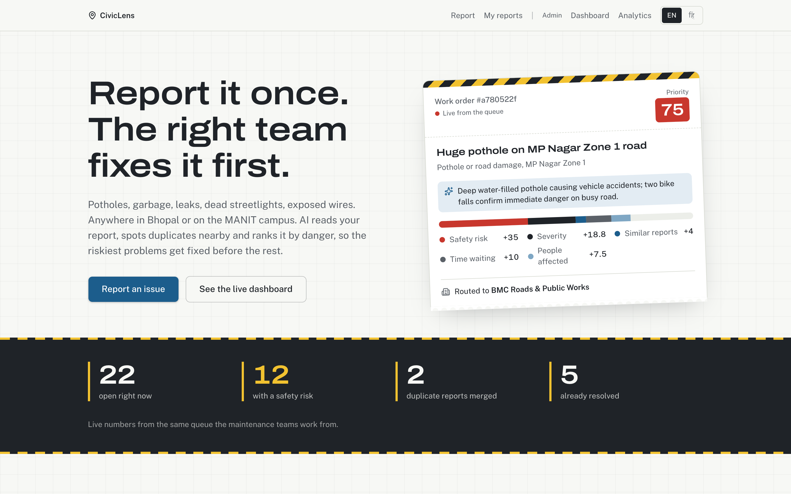

</div>

---

## Contents

- [The problem](#the-problem)
- [What CivicLens does](#what-civiclens-does)
- [Feature tour with screenshots](#feature-tour)
  - [Citizen side](#citizen-side): landing, report form, AI result card, my reports, mobile
  - [Officer side](#officer-side): triage dashboard, map and hotspots, complaint detail, AI "why this rank", analytics
  - [Hindi everywhere](#hindi-everywhere)
- [How the AI pipeline works](#how-the-ai-pipeline-works)
- [Tech stack](#tech-stack)
- [Run it locally](#run-it-locally)
- [Project structure](#project-structure)
- [API reference](#api-reference)
- [Testing](#testing)
- [Privacy and safety](#privacy-and-safety)
- [Limitations and what's next](#limitations-and-whats-next)

---

## The problem

City and campus maintenance teams get complaints as WhatsApp photos, phone calls and paper forms. Nobody can tell which one matters most, the same pothole gets reported ten times, and the person who reported it never hears back. So dangerous problems (an open manhole, a sparking transformer) wait in the same pile as a flickering bulb.

## What CivicLens does

| | For citizens | For officers |
|---|---|---|
| **Report** | Photo, text or voice, in English, Hindi or Hinglish. Drop a pin on the map. No account. | Every report arrives already categorised, scored and routed. |
| **AI triage** | Instant result card: category, severity, safety risk, priority score and which team got it. | One ranked queue, highest danger first, with the reason behind every score. |
| **Duplicates** | "Similar reports nearby" so you know others have reported it too. | Near-duplicates are auto-linked and can be merged or unmerged in one click. |
| **Tracking** | Status timeline on *My reports* (received, triaged, in progress, resolved). | Override status, team or category. Every change is written to an audit trail. |
| **Insight** | | Heatmap, recurring-hotspot bubbles, Street View, analytics charts and CSV export. |

Two organisations run on the same engine: **BMC** (city) and **MANIT** (campus). Dedup, hotspots, routing and analytics are all scoped per organisation.

---

## Feature tour

### Citizen side

#### 1. Landing page

Live numbers come straight from the same queue officers work from (open, safety-risk, duplicates merged, resolved). The ticket on the right is a real top-priority complaint with its score breakdown.


#### 2. Report a problem (`/report`)

- Pick the organisation (**Bhopal city** or **MANIT campus**). The pin must be inside that organisation's area.
- Drop a pin on the Google map, or use your current location.
- Add a **photo** (optional). A photo alone is enough: the AI writes the title.
- Type, or press the **mic** and speak. Voice typing works in English and Hindi.
- Name and contact are optional.

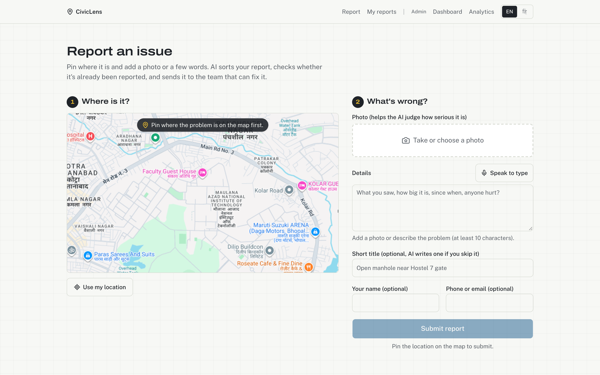

#### 3. AI result card

Seconds after you submit, the card shows what the AI understood: category and confidence, severity, safety risk and community impact (each out of 5), the priority score with its breakdown, the team it was routed to, and similar reports nearby. *(Shown here in Hindi.)*

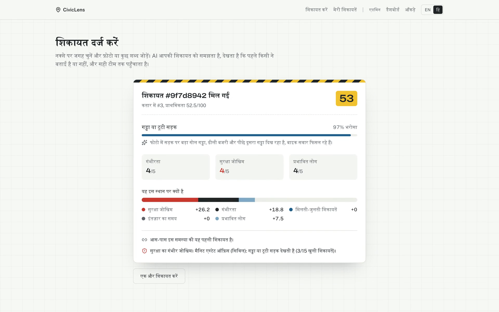

#### 4. My reports (`/my-reports`)

Every report you sent from this device, with a status timeline: received, reviewed by AI, assigned, in progress, resolved. There's no login: report ids are stored on the device, so no personal data is needed.

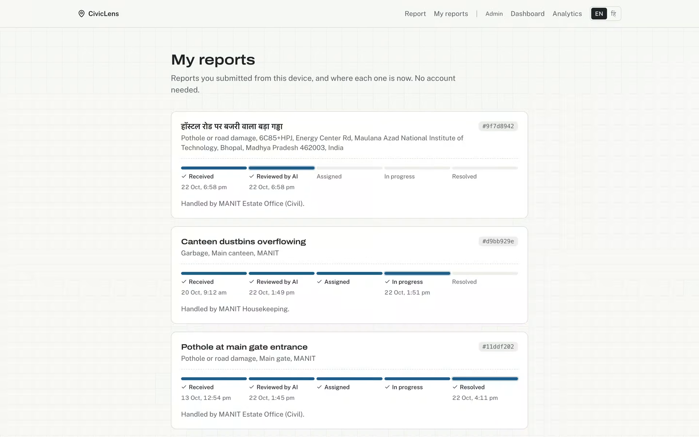

#### 5. Works on phones

Built mobile-first: 40px tap targets, single-column form, and the map works with touch.

<p align="center">
  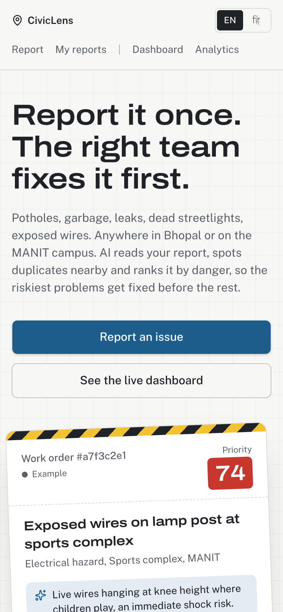
  &nbsp;&nbsp;
  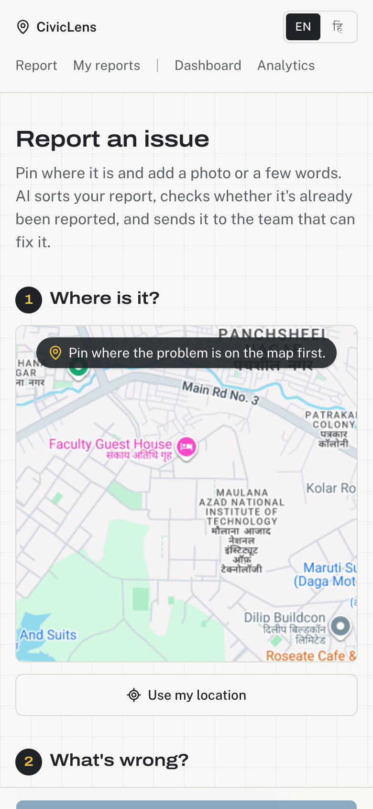
</p>

### Officer side

#### 6. Triage dashboard (`/dashboard`)

The ops console. KPI strip on top (open, safety risk 4 to 5, waiting over 72 h, duplicates merged), then the priority map, then the queue. Switch between **All**, **MANIT campus** and **Bhopal city** with the tabs.

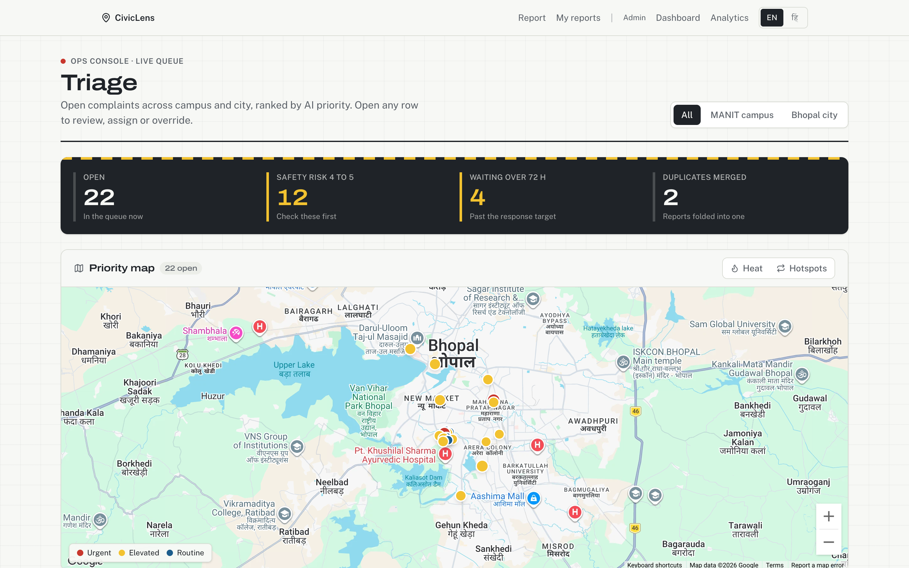

#### 7. Priority map, heatmap and recurring hotspots

Pins are coloured by urgency (urgent, elevated, routine). Toggle **Heat** for a density heatmap or **Hotspots** to see clusters. A cluster with 3 or more reports in 30 days is flagged **Recurring**: a systemic problem, not a one-off.

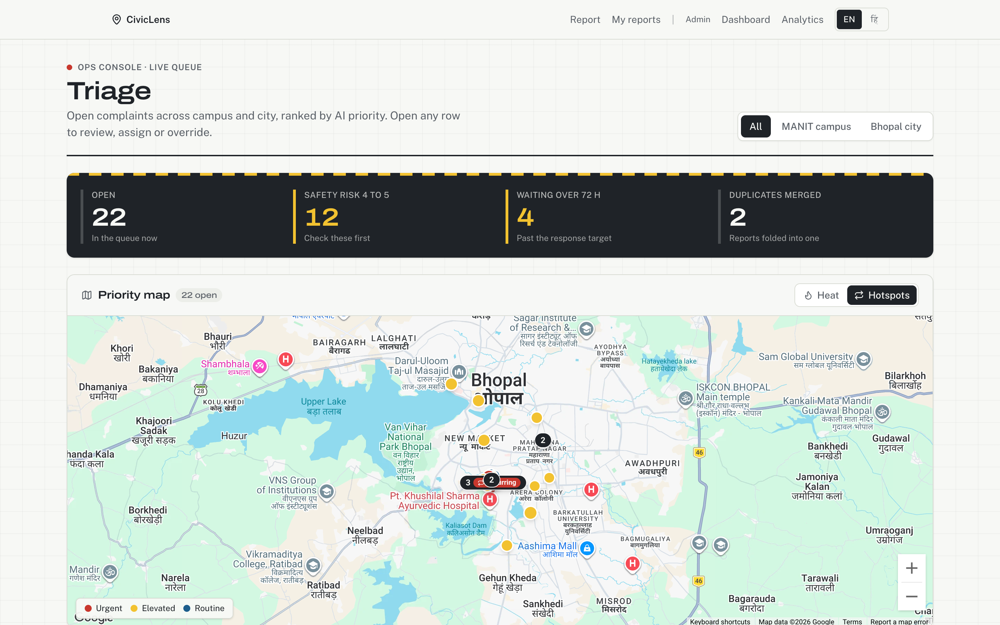

#### 8. Triage queue

Sorted by AI priority. Filter by status and category, sort by highest priority, oldest or newest, and see linked duplicate reports and how long each one has waited (red once it passes the 72 h target). Tick rows to **bulk update** status.

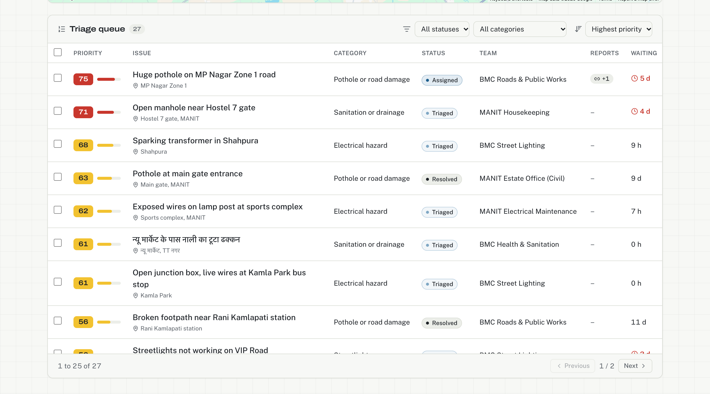

#### 9. Complaint detail (`/complaints/[id]`)

Everything an officer needs on one page:

- **Report**: photo, description, location and **Street View** of the spot before dispatching a crew.
- **AI assessment**: category with confidence, a one-line reasoning, severity, safety and impact scores.
- **Why it scores N**: every factor's contribution to the 0 to 100 priority, so nothing is a black box.
- **Override**: change status, assigned team or category. Each change saves immediately.
- **Merge / Unmerge**: fold a duplicate into the original report. This can be reversed.
- **Activity**: the audit trail of who changed what and when, AI and humans alike.
- **Duplicate reports** and **Related nearby** (within 75 m, last 30 days).

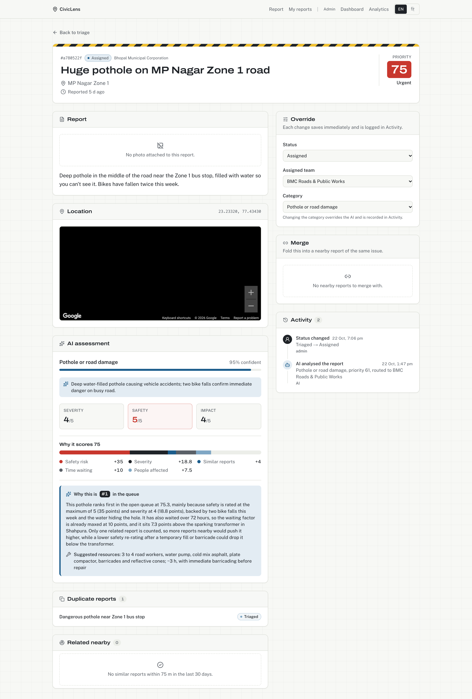

#### 10. Ask the AI "Why this rank?"

One click asks Claude to explain, in plain language, why this complaint sits where it does in the queue compared with the ones around it, what would move it up or down, and which crew and equipment to send.

<p align="center">
  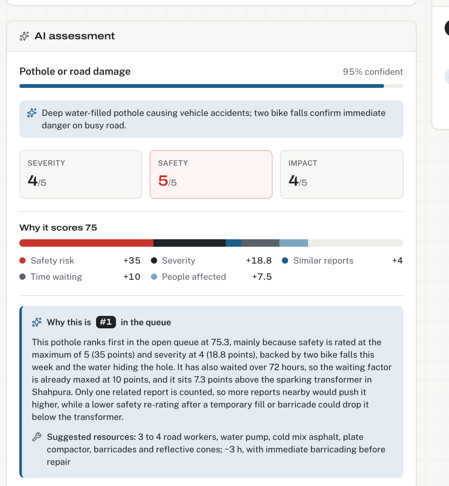
</p>

#### 11. Analytics (`/analytics`)

Counts by category, status and department, a daily reported-vs-resolved trend, average resolution time, and **Export CSV** so ward officers can open the data in Excel.

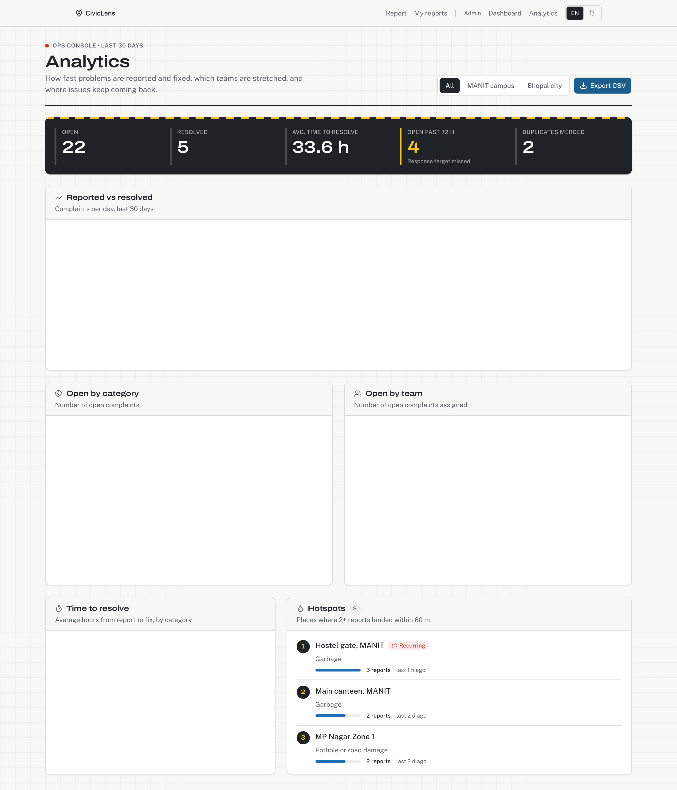

### Hindi everywhere

Every page (citizen and admin), plus the AI's own output, switches between **English** and **हिंदी** with the `EN / हि` toggle in the nav. The choice is remembered in a cookie.

| Landing (Hindi) | Dashboard (Hindi) |
|---|---|
| 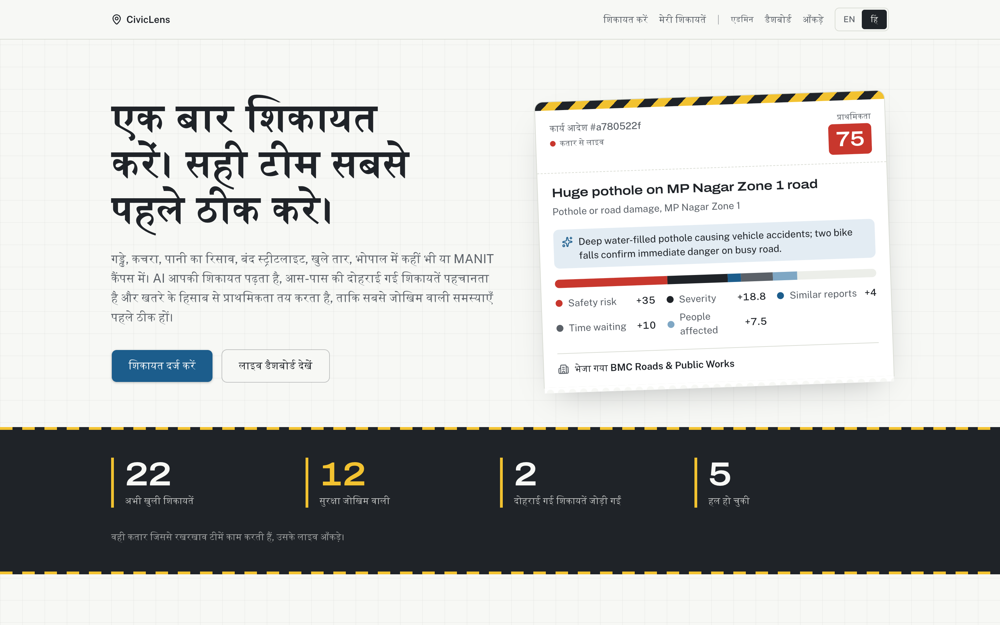 | 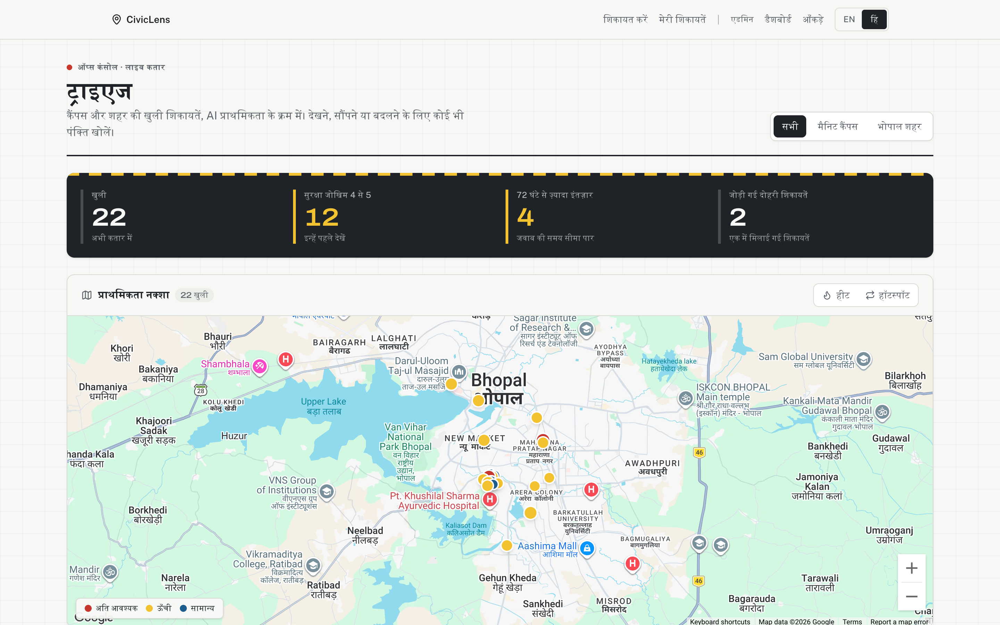 |

---

## How the AI pipeline works

```
photo ──► POST /api/upload (private Vercel Blob)
                │
text/voice ──► POST /api/complaints
                │
                ├─ 1. validate (zod) + check pin is inside the org's area
                ├─ 2. insert complaint
                ├─ 3. classify     Claude Opus 5.5 reads text + photo (EN / HI / Hinglish)
                │                  → category, severity, safety risk, community impact, reasoning
                ├─ 4. embed        Voyage voyage-3-lite, 512-d vector
                ├─ 5. dedup        pgvector cosine + PostGIS distance
                ├─ 6. priority     weighted 0–100 score with a per-factor breakdown
                ├─ 7. route        least-loaded department that handles the category
                └─ 8. audit log    "AI analysed the report" entry
                │
                ▼
        complaint + analysis returned to the AI result card
```

**Categories:** pothole, garbage, water leak, streetlight, electrical, sanitation, other.

**Duplicate detection.** Candidates must be in the same org, within **75 m** and within **14 days**. Cosine similarity of **0.82 or higher** counts as a duplicate, and **0.65 to 0.82** as related.

**Priority score (0 to 100).**

| Factor | Weight | Maxes out at |
|---|---|---|
| Safety risk | 35% | 5 / 5 |
| Severity | 25% | 5 / 5 |
| Related reports nearby | 20% | 5 reports |
| Time waiting | 10% | 72 h (the response target) |
| Community impact | 10% | 5 / 5 |

**Routing.** The complaint goes to the department that handles its category with the lowest open-count-to-capacity ratio (for example, MANIT Housekeeping 7/12). The routing reason is shown to officers.

**Hotspots.** PostGIS `ST_ClusterDBSCAN` with eps 60 m and minPoints 2. Three or more reports in 30 days counts as **Recurring**.

**If Claude is down,** the complaint is still saved as `other` with a fallback flag, so a citizen never loses a report. An officer can re-categorise it, and that change is audit-logged.

---

## Tech stack

| Layer | Choice |
|---|---|
| Framework | Next.js 15 (App Router, Turbopack), React 19, TypeScript |
| UI | Tailwind CSS 4, shadcn/ui (Base UI), lucide icons, Recharts, TanStack Table, sonner |
| Maps | Google Maps JS via `@vis.gl/react-google-maps`: heatmap, Street View |
| AI | Anthropic Claude **Opus 5.5** (`claude-opus-5-5`) for classification and "why this rank"; Voyage `voyage-3-lite` embeddings |
| Database | Neon serverless Postgres + **PostGIS** (locations, clustering) + **pgvector** (HNSW cosine search), Drizzle ORM |
| Storage | Vercel Blob (private), served only through `/api/photos` |
| Validation | zod 4, on every API input and on env vars at startup |
| Tests | Vitest |
| Hosting | Vercel |

---

## Run it locally

### 1. Prerequisites

- **Node.js 22+** and npm
- A **Neon** Postgres database (the free tier is fine) with the `postgis` and `vector` extensions. The first migration enables them.
- API keys: **Anthropic**, **Voyage AI**, **Google Maps** (Maps JavaScript API), and optionally a **Vercel Blob** token for photo uploads.

### 2. Install

```bash
git clone https://github.com/anirudh12032008/webforge.git
```

```bash
cd webforge && npm install
```

### 3. Environment variables

Copy the template and fill it in:

```bash
cp .env.example .env.local
```

| Variable | Required | What it's for |
|---|---|---|
| `DATABASE_URL` | yes | Neon connection string (`...?sslmode=require`) |
| `ANTHROPIC_API_KEY` | yes | Claude classification and explanations |
| `VOYAGE_API_KEY` | yes | Embeddings for duplicate detection |
| `NEXT_PUBLIC_GOOGLE_MAPS_API_KEY` | yes | Maps, heatmap, Street View |
| `BLOB_READ_WRITE_TOKEN` | no | Photo upload. Without it, reports are text-only. |

The app validates these at startup and lists any missing or invalid keys by name.

### 4. Database

```bash
npm run db:migrate
```

Seed the two orgs (BMC and MANIT, including the campus boundary from `Manit campus.geojson`) and their departments:

```bash
npm run db:seed
```

Optional: seed demo complaints from `data/seed-complaints.json`. Each one goes through the real AI pipeline, so it takes about 20 s per report because of Voyage's free-tier rate limit.

```bash
npm run db:seed:complaints
```

### 5. Start

```bash
npm run dev
```

Open http://localhost:3000. Citizen pages are `/`, `/report` and `/my-reports`. The officer console is `/dashboard`, `/complaints/[id]` and `/analytics`.

### All scripts

| Script | Does |
|---|---|
| `npm run dev` | Dev server with Turbopack |
| `npm run build` / `npm start` | Production build and serve |
| `npm test` | Run the Vitest suite |
| `npm run typecheck` | `tsc --noEmit` |
| `npm run lint` | ESLint |
| `npm run db:generate` | Generate a Drizzle migration from `schema.ts` |
| `npm run db:migrate` | Apply migrations |
| `npm run db:studio` | Browse the DB in Drizzle Studio |
| `npm run db:seed` | Seed orgs and departments |
| `npm run db:seed:complaints` | Seed demo complaints through the AI pipeline |

---

## Project structure

```
src/
├── app/
│   ├── page.tsx                  Landing page (live stats)
│   ├── (citizen)/report          Report form
│   ├── (citizen)/my-reports      Status timelines for this device's reports
│   ├── (admin)/dashboard         KPIs, priority map, triage queue
│   ├── (admin)/complaints/[id]   Detail, override, merge, audit trail
│   ├── (admin)/analytics         Charts and CSV export
│   └── api/                      Route handlers (see API reference)
├── components/
│   ├── report/                   Form, photo field, voice input, AI result card, timelines
│   ├── admin/                    Triage table, bulk actions, overrides, merge, explain, Street View
│   ├── map/                      Location picker, heatmap overlay, hotspot bubbles
│   ├── analytics/                Bar and trend charts
│   └── shared/                   Top nav, language switch, locale provider
├── lib/
│   ├── ai/                       classify, embed, dedup, priority, routing, explain
│   ├── geo/                      Hotspot clustering
│   ├── i18n/                     English + Hindi dictionaries
│   └── validation.ts             zod schemas for every API input
├── db/                           Drizzle schema, client, queries
└── env.ts                        Env var validation
drizzle/                          SQL migrations (extensions, schema, orgs)
scripts/                          Seed scripts
```

---

## API reference

| Method | Route | Purpose |
|---|---|---|
| `POST` | `/api/upload` | Upload a photo to private Blob storage |
| `GET` | `/api/photos/[...path]` | Proxy that serves stored photos |
| `POST` | `/api/complaints` | Create a complaint and run the full AI pipeline |
| `GET` | `/api/complaints` | List complaints (filters: `org`, `status`, `category`, `department`, `bbox`, `sort`, `page`) |
| `GET` / `PATCH` | `/api/complaints/[id]` | Read a complaint, or override status, team or category (audit-logged) |
| `GET` | `/api/complaints/[id]/explain` | Ask Claude "why this rank?" |
| `POST` / `DELETE` | `/api/complaints/[id]/merge` | Merge into another report / unmerge |
| `POST` | `/api/complaints/bulk` | Bulk status update |
| `POST` | `/api/my-reports` | Status of the reports whose ids this device holds |
| `GET` | `/api/clusters` | Hotspot clusters for the map |
| `GET` | `/api/analytics` | Aggregates for the analytics page |
| `GET` | `/api/export` | CSV export |
| `GET` | `/api/orgs` | Organisations and their departments |

All inputs are validated with zod and return a readable 400 when invalid.

---

## Testing

```bash
npm test
```

There are 42 unit tests covering input validation, the priority formula, classification parsing and fallback, embeddings, dedup thresholds, hotspot clustering, merge and unmerge, overrides, report history, geography helpers and CSV export.

---

## Privacy and safety

- **No accounts and no required personal data.** Name and contact are optional. *My reports* works from ids stored on the device.
- **Photos are private.** They're kept in private Blob storage and served only through the `/api/photos` proxy, never with a public URL.
- **Every change is audited.** AI analysis, status, team and category overrides, and merges and unmerges are all written to `audit_log`.
- **Nothing is deleted by triage.** Duplicates are merged, not removed, and every merge can be undone.
- **Location is checked.** A report must fall inside the chosen organisation's boundary.

---

## Limitations and what's next

- Admin pages have no authentication or roles yet. That's the first thing to add before real use.
- Intake over SMS and WhatsApp.
- SLA breach alerts to department heads.
- Voyage's free tier rate-limits embeddings, so bulk ingestion is throttled to about one report every 20 s.

---

<div align="center">
Built for Bhopal 🇮🇳 · Hackathon project, 2026
</div>
